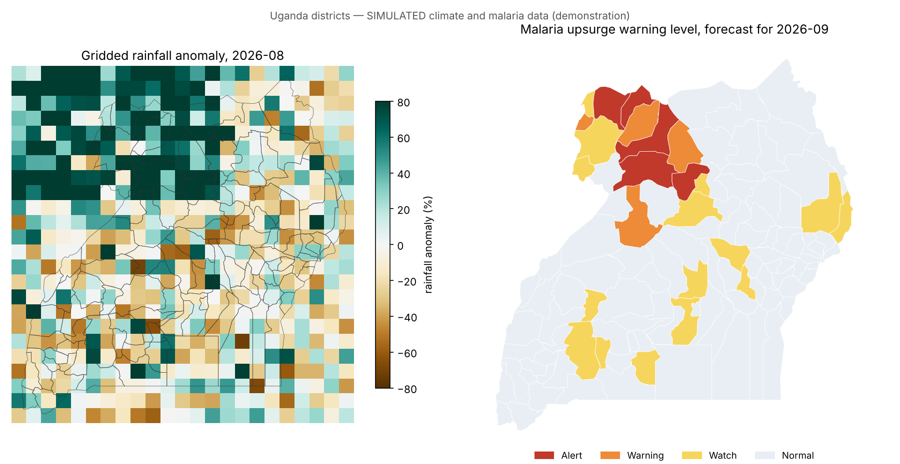
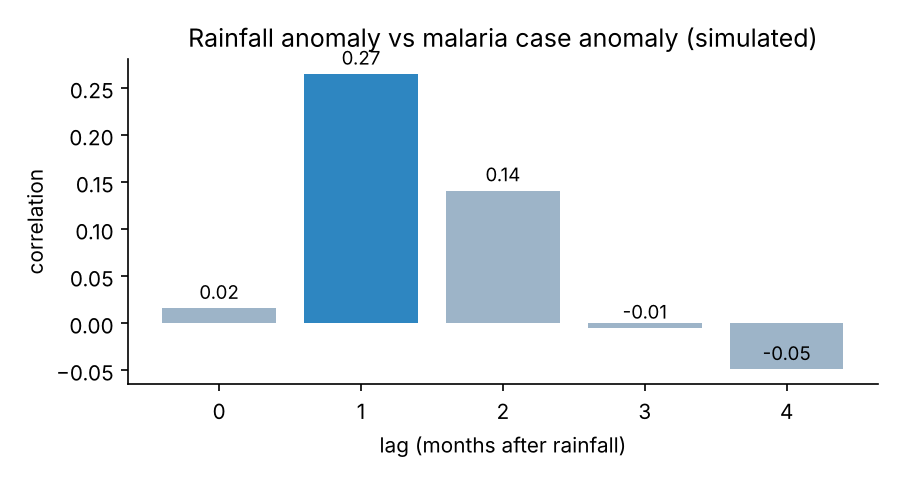
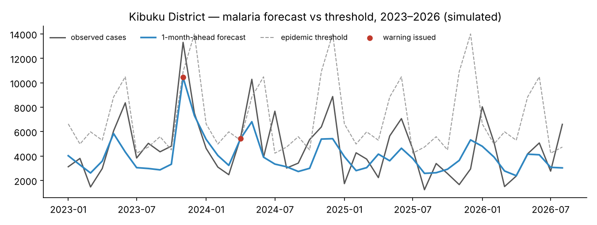

# climate-malaria-early-warning

**A climate-informed early-warning system that forecasts malaria upsurges in Ugandan districts one month ahead — from gridded rainfall and temperature to standards-compliant alerts.**

Rainfall creates mosquito breeding sites and temperature controls parasite development, so malaria cases rise a few weeks after wet, warm months. This repository builds the full operational chain:

**gridded climate (NetCDF) → district zonal statistics → lag analysis → forecast model → epidemic-threshold probability → warning level → CAP alerts → map / GeoJSON / PostGIS views**

> **Data notice.** District names and boundaries are real (112 districts, [Natural Earth](https://www.naturalearthdata.com/), public domain). **Climate and malaria figures are simulated** to mimic CHIRPS rainfall, ERA5 temperature and HMIS malaria reports; no real surveillance data are included. A heavy-rain scenario over West Nile and Acholi in July–August 2026 is part of the simulation. CAP messages are marked `status=Exercise`. See [data/REAL_DATA.md](data/REAL_DATA.md) to switch to real sources.



## What it does

| Step | Detail | Code |
|---|---|---|
| Gridded climate | Monthly 0.25° rainfall and temperature grid over Uganda (2015–2026) written as **CF-compliant NetCDF**, with bimodal/unimodal rainy seasons and cooler highlands | `climalaria/climate.py` |
| Zonal statistics | Grid cells → district means via spatial join (nearest cell for very small districts) | `climalaria/climate.py` |
| Malaria data | Monthly confirmed cases per district driven by lagged rainfall, temperature suitability and regional endemicity | `climalaria/malaria.py` |
| Lag analysis | Correlation between rainfall and case anomalies at 0–4 months | `climalaria/model.py` |
| Forecast model | Negative-binomial regression with population offset, district effects, seasonality, rainfall lags 1–2 and temperature suitability; trained 2015–2022, tested 2023–2026 | `climalaria/model.py` |
| Warning | WHO-style **epidemic threshold** (mean + 2 SD per district and calendar month); the model gives the **probability of exceeding it next month** → WATCH / WARNING / ALERT | `climalaria/model.py` |
| Alerts | **CAP 1.2** messages with district polygons and geocodes, validated | `climalaria/cap.py` |
| Database | PostGIS schema: grid cells, zonal-statistics view, epidemic-threshold view, latest status view for GeoServer | `postgis/schema.sql` |

## Results (simulated data)

**Rainfall leads malaria by about one month:**



| Lag (months) | 0 | **1** | 2 | 3 | 4 |
|---|---|---|---|---|---|
| Correlation | 0.02 | **0.27** | 0.14 | −0.01 | −0.05 |

The model recovers this: **+50 mm of rain raises next month's cases by about 26%** (and by about 13% two months later).

**Warning skill on 2023–2026** (WARNING or ALERT issued, compared with months that actually exceeded the threshold):

| Model | Epidemic months | Detected | Hit rate | False-alarm ratio |
|---|--:|--:|--:|--:|
| Seasonal only (no climate) | 452 | 60 | 0.13 | 0.74 |
| **Climate-informed** | 452 | 133 | **0.29** | **0.48** |

Adding climate more than doubles the hit rate and cuts false alarms. Many exceedances remain hard to forecast a month ahead: monthly case counts are noisy, and the threshold is set on historical variability. In practice, warnings would be combined with weekly surveillance (mTrac/eIDSR) and seasonal climate outlooks from ICPAC and UNMA.

**Forecast for September 2026:** after the simulated July–August heavy rains, 5 districts in West Nile and Acholi reach ALERT and 4 reach WARNING; 9 CAP alerts were issued and validated.



## Quick start

```bash
pip install -r requirements.txt
python run_pipeline.py       # writes outputs/: NetCDF grid, CSV, GeoJSON, maps, cap_alerts/*.xml
pytest -q                    # 6 tests: zonal stats, highland temperatures, lag, model effect, probabilities, CAP
```

PostGIS (tested on PostgreSQL 16 with PostGIS 3):

```bash
psql -d ews -f postgis/schema.sql
ogr2ogr -f PostgreSQL PG:"dbname=ews" data/uganda_districts.geojson -nln admin.districts -lco GEOMETRY_NAME=geom
# real CHIRPS rasters: raster2pgsql -s 4326 -I -C -t 50x50 -F chirps-v2.0.2026.08.tif climate.chirps_monthly | psql ews
```

## Design notes

- **Probabilities, not just predictions.** Decision-makers need "how likely is an upsurge", so the warning comes from the probability of exceeding the epidemic threshold under the model's negative-binomial uncertainty.
- **Honest evaluation.** The model is trained on 2015–2022 and judged on unseen 2023–2026 data against a no-climate baseline.
- **Warning authority stays with people.** CAP messages are prepared for the designated approving authority and generated as `Exercise`.

## License

MIT © Moses Kizito
